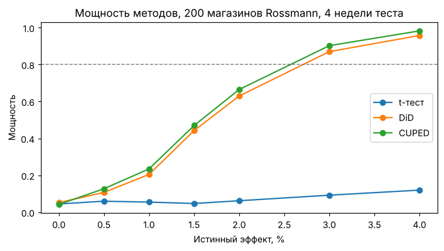
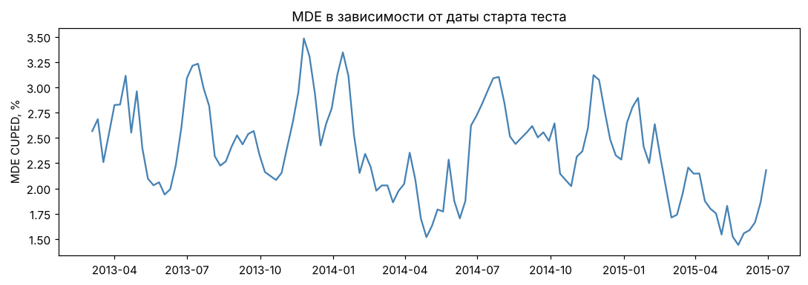

# A/B-тесты на магазинах: CUPED, DiD и проверка методов на данных Rossmann

Мини-проект про офлайн-эксперименты в ритейле: рандомизация на уровне магазинов, расчет MDE, снижение дисперсии и проверка корректности методов через A/A-тесты на реальных данных.

## Задача и подход

Сеть магазинов тестирует изменение и хочет понять, выросла ли недельная выручка. Магазинов мало, а различаются они в разы, поэтому обычный t-тест почти бесполезен.

Данные – [Rossmann Store Sales](https://www.kaggle.com/competitions/rossmann-store-sales): продажи и число покупателей 1115 магазинов за 2013–2015 годы. Эксперименты полусинтетические: на реальных данных случайно выбираются 200 магазинов и дата старта, магазины делятся на тест и контроль, эффект добавляется вручную. Так известен правильный ответ, а весь шум – настоящий.

## Основные результаты

| | t-тест | DiD | CUPED |
|---|---|---|---|
| MDE на 200 магазинах | ~14% | ~3.2% | ~2.5% |
| Ошибка I рода (1000 A/A-тестов) | 5.3% | 4.4% | 3.9% |
| Мощность при эффекте 2% | 6% | 63% | 67% |

- Учет пред-периода сокращает необходимое число магазинов примерно в 30 раз.
- MDE зависит от календаря: от 1.4% весной до 3.5% перед Рождеством.
- Анализ среднего чека по магазино-неделям вместо магазинов дает ~29% ложных срабатываний (псевдорепликация). Дельта-метод держит 5% и совпадает с бутстрапом.
- Парная рандомизация с обычным t-тестом делает тест слишком консервативным: анализ должен соответствовать дизайну.




## Структура

```
abkit/
  data.py        загрузка Rossmann, случайные окна, синтетический генератор для тестов
  design.py      рандомизация (простая и парная), MDE, размер выборки
  methods.py     t-тест Уэлча, DiD, CUPED, дельта-метод, бутстрап
  simulation.py  A/A и A/B симуляции
tests/           pytest
analysis.ipynb   основной анализ с выводами
```

## Запуск

Скачать `train.csv` и `store.csv` со страницы соревнования на Kaggle и положить в папку `data/` (или `kaggle competitions download -c rossmann-store-sales`).

```
pip install -r requirements.txt
pytest
jupyter notebook analysis.ipynb
```

## Что можно развить

CUPED для ratio-метрик, CUPAC (ML-предсказание вместо пред-периода), стратификация по типу магазина, синтетический контроль, поправки на множественное тестирование.
